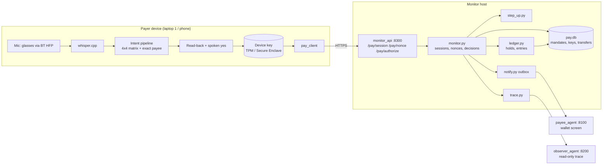
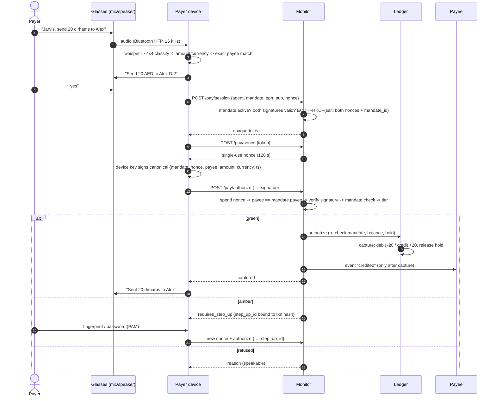
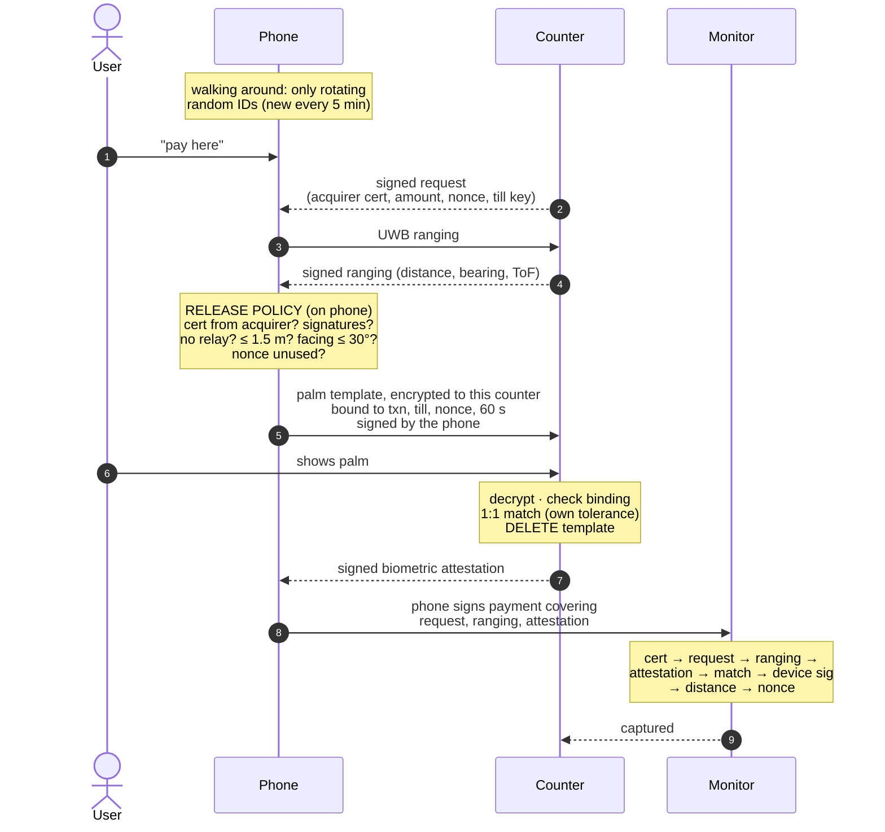
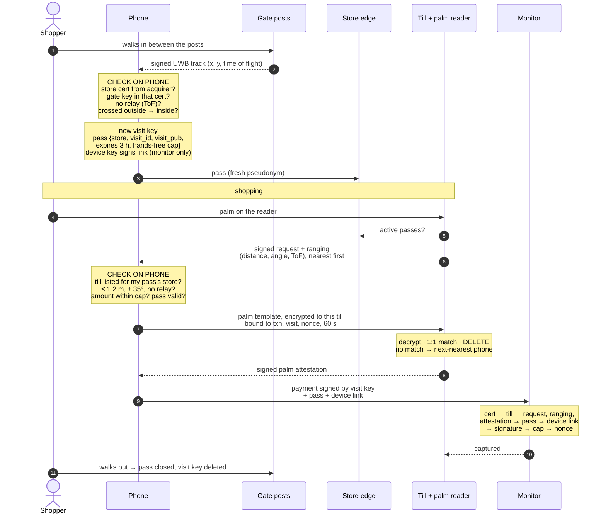
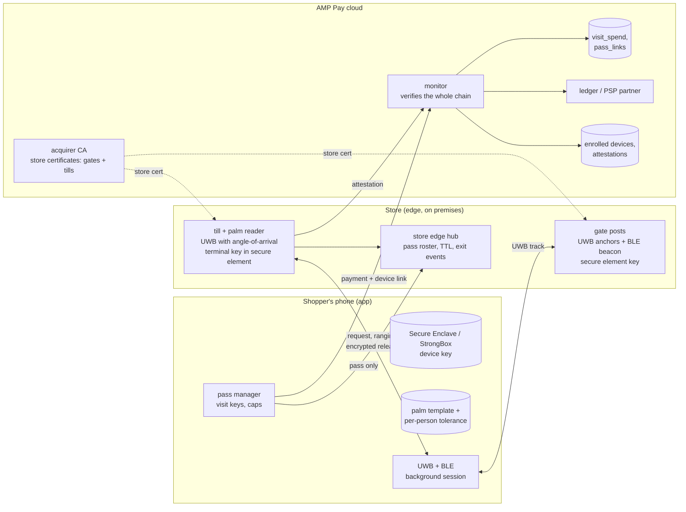

# AMP Pay — Backend Architecture and Protocol Specification

> **CONFIDENTIAL — PRE-PATENT.** Do not publish, present publicly or commit to any public repository
> before a patent application is filed. Share only under NDA.
> Owner: Sagar Uniyal. Status as of 30 Sep 2026: working prototype + six invention prototypes, all
> with real cryptography (ranging simulated, biometric samples synthetic where stated).
>
> **Lead invention (§7.0, §7.0.1): pay with your palm, and nobody keeps it.** The biometric never
> leaves the payer's phone except, encrypted, to the one certified till the payer is standing at, for
> one payment. With a store pass issued by walking through the store's entrance gate, the payer only
> puts a palm on the reader — no card, no phone in hand — and the store still cannot recognise or
> track them between visits.

---

## 1. What the system does

A person says a payment ("send 20 dirhams to Alex", "pay here") into any listening device —
glasses, earbuds, a watch, a car, an AI agent. The backend turns that sentence into a **proposal**,
and a **hardware-held device key** turns an approved proposal into an **authorization**. Money moves
only when a **monitor** and a **ledger** independently confirm the authorization fits a **mandate**
that both parties signed in advance.

### The invariants (every design decision below serves one of these)

| # | Invariant | Enforced in |
|---|---|---|
| I1 | **Voice proposes, never selects.** Speech recognition and any semantic search sit outside the security boundary. | `app/intent.py` |
| I2 | **Exact payee binding.** A payee is resolved by exact token match against the payer's own mandate roster. Zero or several matches = refuse. No similarity threshold anywhere. | `intent.RosterResolver` |
| I3 | **Authority is agreed once, by both parties.** A mandate is valid only with the payer's AND the payee's signature. Speech can only exercise it. | `app/mandate.py`, `monitor.open_session` |
| I4 | **Only the device key authorizes.** Every transfer carries a signature from a key sealed to the payer's hardware, over the exact transaction. | `app/device_key.py`, `monitor.authorize_transfer` |
| I5 | **Approvals are not fungible.** Nonces are single-use and short-lived; step-up approvals are bound to a hash of the exact transaction. | `monitor._spend_nonce`, `step_up.binding` |
| I6 | **Two independent checks.** Monitor and ledger each re-check the mandate; neither trusts the other's verdict. | `monitor`, `ledger.authorize` |
| I7 | **The ledger cannot lie.** Append-only, double-entry, derived balances, idempotent, invariant-checked. | `app/ledger.py` |
| I8 | **Refusals are speakable.** Every rejection carries a reason safe to read aloud. | all `*Error` classes |
| I9 | **No central biometric store.** A biometric template lives only on the user's device and is released only to the one certified counter the user is physically facing, encrypted to it, for one transaction, matched 1:1, then deleted. | `proto/biorelease.py` (§7.0) |
| I10 | **Checking in is not being identified.** A store pass carries a fresh key per visit; only the payment provider can link a visit to a person, and only when a payment is made. | `proto/storepass.py` (§7.0.1) |

---

## 2. Components



| Component | File | Responsibility |
|---|---|---|
| Voice daemon | `~/glasslink/jarvis-voice/jarvis_voiced.py` | Glasses audio in/out, wake word, STT, read-back, spoken confirmation |
| Payment bridge | `~/glasslink/jarvis-voice/jarvis_pay.py` | Runs `pay_client.py` as a subprocess in amp's venv (key and ledger stay behind one entry point) |
| Pay client | `~/amp/pay_client.py`, `send.sh` | Local intent resolution, session, nonce, device signature, authorize call |
| Intent pipeline | `app/intent.py` | Classify, parse amount/currency, resolve payee exactly, build read-back |
| Mandates | `app/mandate.py`, `app/mandate_store.py` | Mandate model, two-party signatures, pure `check()`, keys, transfers, counters |
| Monitor | `app/monitor.py`, `monitor_api.py` | The only authorizer. Sessions, keys, nonces, ordered checks, decision log |
| Device key | `app/device_key.py` | TPM-sealed Ed25519 or TPM-resident P-256; canonical signing payload |
| Step-up | `app/step_up.py` | Second channel for amber: PAM fingerprint / password, bound to the transaction |
| Ledger | `app/ledger.py` | Accounts, two-phase holds, double-entry, reversals, invariant |
| Events | `app/notify.py` | Per-agent outbox; emitted only after capture |
| Trace | `app/trace.py` | Stage-by-stage record for the observer and audits |
| Payee wallet | `payee_agent.py` | Wallet screen; balance read from the ledger, never from events |
| Observer | `observer_agent.py`, `web/observer.html` | Read-only live flow for demos; no route can move money |

All payment state lives in `data/pay.db`, separate from the agent-mesh database, so nothing in
the mesh can alter what a mandate permits.

---

## 3. Data model (`data/pay.db`)

```text
agent_keys   (agent_id PK, public_key hex Ed25519, enrolled, note)
mandates     (mandate_id PK, payer_agent, payee_agent, currency, state, doc JSON, created, updated)
             state: proposed | active | revoked | expired
transfers    (transfer_id PK, mandate_id, idempotency_key UNIQUE, amount, currency, state, ts, detail JSON)
             state: authorized | captured | reversed | failed
accounts     (account_id PK, owner, currency, opened)
entries      (entry_id PK, txn_id, account_id FK, amount signed, currency, kind transfer|reversal, ts, ref)
holds        (hold_id PK, transfer_id, account_id, amount, state active|released, expires, ts)
sessions     (session_id PK, token UNIQUE opaque, agent_id, mandate_id, send_key, recv_key,
              generation, counter, opened, rotated, expires, state)
session_nonces (nonce PK, session_id, issued, expires, spent_at)
decisions    (decision_id PK, ts, session_id, mandate_id, nonce, verdict green|amber|refused, reason,
              amount, currency, transfer_id, evidence JSON)   append-only
step_ups     (step_up_id PK, session_id, mandate_id, binding sha256, detail, state, channel,
              created, expires, settled)   state: pending | approved | denied | expired
events       per-agent outbox (notify.py)
traces       per-nonce stage records (trace.py)
```

### The mandate document (both parties sign `canonical()` of these fields)

```json
{
  "mandate_id": "mdt_…", "version": 1,
  "payer": {"agent_id": "agt_sagar", "wallet": "wal_sagar", "display_name": "Sagar Uniyal"},
  "payee": {"agent_id": "agt_alex", "wallet": "wal_alex", "display_name": "Alex D."},
  "currency": "AED",
  "limits": {"per_txn": 500, "per_day": 1000, "per_month": 5000, "max_txn_per_hour": 10},
  "green_tier_cap": 50,
  "not_before": "…", "not_after": "…",
  "purposes": ["peer_transfer"],
  "payer_sig": "<Ed25519 over canonical fields>", "payee_sig": "<Ed25519 over canonical fields>"
}
```

Canonicalisation everywhere: `json.dumps(obj, sort_keys=True, separators=(",", ":"))`.
Concatenation with separators is never used, so a character cannot be moved across a field
boundary (`"20|AED"` vs `"2|0AED"`).

---

## 4. End-to-end flow of one spoken payment



### 4.1 Intent pipeline (device side, `app/intent.py`)

1. **Transcribe** — whisper.cpp, primed with the roster names (the voice daemon's `whisper_prompt`).
2. **Classify with the 4×4 matrix** — verb classes `transfer | query | message | other` ×
   object slots `person | amount | currency | time`. Each verb class has its own marker set per
   slot; a sentence is a transfer only if the transfer verb and the required slots are present.
   A currency word alone can promote a sentence to transfer ("twenty dirhams to Alex").
3. **Parse the amount, fail closed** — digits or number words ("twenty", "20" → 20);
   ambiguous forms ("twenty twenty") refuse. Currency from a closed dictionary (AED/dirham, USD,
   INR, EUR …).
4. **Resolve the payee exactly** — candidates are the payer's active mandates, newest per payee.
   Score = count of shared name tokens; best score must be unique, else "that could be A, B —
   which one?". No edit distance, no embeddings as a decider. (`OpenSearchResolver` may *suggest*
   aliases, but its output is re-bound through the exact rule.)
5. **Read back** — "Send 20 AED to Alex D.?" The voice daemon accepts a narrower affirmative
   vocabulary for money (`PAY_AFFIRM`) than for messages.

Nothing up to here has any authority.

### 4.2 Session establishment (`monitor.open_session`)

- Refuses unless the mandate exists, is active, the agent is a party, and **both** signatures verify
  against enrolled keys.
- X25519 ECDH between the device's ephemeral key and a fresh monitor ephemeral key.
- `HKDF-SHA256(shared, salt = agent_nonce ‖ monitor_nonce ‖ mandate_id)` → send/recv keys.
  Salting with the mandate id makes the keys useless for any other mandate.
- Opaque 32-byte token; the monitor holds all state it maps to (nothing to parse or forge).
- Session TTL 1 h. Symmetric ratchet every 300 s: `k_next = HKDF(k, "amp-rotate")`, old keys discarded.
- Payloads that need confidentiality use ChaCha20-Poly1305 with a strict per-session counter nonce
  (IETF 96-bit variant; the design doc named XChaCha20 — known, documented deviation).

### 4.3 Authorization — the ordered checks (`monitor.authorize_transfer`)

Order matters; each step refuses with a speakable reason and writes a decision row.

1. **Spend the nonce first** (before any other work), so two racing replays cannot both pass.
2. **Payee equality** — the requested payee wallet must equal the mandate's payee wallet.
3. **Device key present** for the payer; **signature verifies** over the canonical transaction.
4. **`Mandate.check(amount, currency, spent_today, spent_month, txns_last_hour)`** — pure function:
   revoked / not yet active / expired / wrong currency / non-positive / over per-txn / over day /
   over month / velocity → refuse; else tier `green` if `amount ≤ green_tier_cap`, else `amber`.
   Counters count only **captured** transfers.
5. **Amber** → create a step-up challenge bound to `sha256(mandate, payee_wallet, amount, currency)`
   and return `requires_step_up` — **no money moves**. A retry with a *new* nonce and an approved,
   matching, unconsumed `step_up_id` proceeds; the approval is consumed atomically.
6. **Ledger authorize** (outside the monitor lock) — independently re-runs `check()`, verifies both
   accounts exist in the currency, payer ≠ payee, available balance (entries − active holds) ≥
   amount; inserts a hold (TTL 300 s) and a transfer row keyed by
   `idempotency_key(mandate_id, nonce)`. A repeat returns the original transfer (`replayed: true`).
7. **Ledger capture** — posts the double-entry pair, releases the hold. Idempotent.
8. **Emit `credited`** to the payee's outbox — strictly after capture, so an event can only describe
   money that already moved.

### 4.4 Step-up (`app/step_up.py`)

- `CHALLENGE_TTL = 120 s`. States `pending → approved | denied | expired`, then consumed once.
- Channels behind one interface (`Channel.confirm(prompt, detail)`): `Fingerprint` (fprintd via PAM)
  preferred, `Password` (PAM via `unix_chkpwd`, unprivileged) fallback.
- The prompt shows payee name, wallet, amount, currency — what the human approves is what is bound.
- **Known gap:** `present()` runs where the monitor database is. In a remote deployment the approval
  must happen on the payer's own device → see §7.5 (phone Face ID approval), which closes it.

### 4.5 Ledger rules (`app/ledger.py`)

- Append-only; a correction is `reverse(transfer_id, reason)` → a compensating pair with `ref`.
- Balances are `SUM(entries)`; available = balance − active holds. No stored balance columns.
- `expire_holds()` frees authorizations that never captured.
- `check_invariant()` — every txn's entries sum to zero and the whole book sums to zero; any
  failure means the ledger is lying and everything downstream is suspect.

### 4.6 Device key (`app/device_key.py`)

| Backend | Key custody | Algorithm | Notes |
|---|---|---|---|
| `SealedEd25519` | private key encrypted to this machine's TPM (`systemd-creds --with-key=tpm2`), unsealed only to sign | Ed25519 | Blob is inert on another machine; key in memory while signing (stated limitation) |
| `Tpm2Pkcs11` | generated and kept inside the TPM | ECDSA P-256 | Needs tpm2-pkcs11 + `tss` group; TPMs rarely implement Ed25519 |

`load()` prefers hardware and reports which backend signed (`hardware_resident`), so risk policy
can take custody into account. TPM calls retry briefly under resource-manager contention.

---

## 5. APIs

### Monitor (`monitor_api.py`, default :8300, behind `/pay` on the hub)

| Method | Path | Body | Returns |
|---|---|---|---|
| POST | `/pay/session` | `{agent_id, mandate_id, eph_pub, nonce}` | `{session_id, token, monitor_eph_pub, monitor_nonce, expires}` |
| POST | `/pay/nonce` | `{token}` | `{nonce, expires}` |
| POST | `/pay/authorize` | `{token, nonce, payee_wallet, amount, currency, timestamp, signature, step_up_id?, evidence?}` | `captured {transfer_id, txn_id, tier}` · `requires_step_up {step_up_id, expires}` · error `{reason}` |

Deliberately absent from the network: minting mandates, enrolling keys, and anything that moves
money without a device signature.

### Payee (`payee_agent.py`, :8100) and observer (`observer_agent.py`, :8200)

Payee: wallet screen, polls its outbox (`notify.poll(agent, since)`), balance from `ledger.balance`.
Observer: read-only trace stream (`trace.since(seq)`), stages listed in `trace.STAGES`.

---

## 6. Threat model

| Threat | What stops it |
|---|---|
| Mis-heard payee ("Riley" → "the worm") | I2 exact binding; §7.1 collision-free namespace |
| Cloned / replayed voice | No device signature; I4 |
| Replayed network request | Single-use nonce spent first; idempotency key |
| Stolen session token | Token only maps to state; keys bound to mandate; 1 h TTL; ratchet |
| Compromised app asks for more | Mandate limits checked by monitor AND ledger (I6) |
| Approval reused for a bigger amount | Step-up bound to transaction hash (I5) |
| Duplicate capture / double spend | Idempotency key UNIQUE; two-phase hold |
| Ledger tampering | Append-only, derived balances, `check_invariant()` |
| Fake merchant beacon | §7.3 acquirer-certified terminal key + check words |
| NFC-style relay attack | §7.3 time-of-flight distance bound |
| Someone else finishes a started payment | §7.2 hand continuity |
| Compromised laptop shows one thing, signs another | §7.5 phone approval: the trusted screen signs what it shows |
| Device theft | Key sealed to hardware; phone key requires current biometric; §7.0 counter 1:1 check fails for the thief |
| Central biometric database breach | None exists: templates live only on user devices (I9, §7.0) |
| Mall-wide tracking by merchants | Rotating unlinkable beacons; biometric released only to the till being paid (§7.0) |
| Captured biometric release | Encrypted to one terminal's ephemeral key, bound to one request, 60 s, single use (§7.0) |
| Fake or relayed entrance gate | Gate key must be listed in the acquirer-signed store certificate; ToF slack refuses relays (§7.0.1) |
| Walking past a store issues a pass | Track must cross ≥0.6 m outside → ≥0.6 m inside between the posts, on consecutive samples (§7.0.1) |
| Stolen / copied store pass | Useless without the per-visit key, which never leaves the phone; closed on exit; 3 h expiry |
| Till of one store harvesting palms of shoppers in another | Phone releases only to tills listed in the certificate of the store it holds a pass for |
| Bystander's palm released in a queue | Nearest-first order; release only inside 1.2 m ±35°; deleted after one 1:1 comparison |
| Large hands-free charge | Per-visit cap checked on the phone before release and again by the monitor; above it → Face ID |

---

## 7. The inventions (prototypes in `~/amp/proto`)

Run everything: `cd ~/amp/proto && ./run_all.sh` (`--quick` for a 2-minute voice test). Results land
in `proto/results/`, the pitch report in `proto/report/index.html`.

### 7.0 Presence-gated one-time biometric release — KEY INVENTION AND SELLING POINT (`biorelease.py`)

> **Pitch line: "Amazon One convenience without anyone holding your palm."** Walk up to any till,
> say "pay here", show your hand, done — a stolen card or phone is useless, and no merchant, mall or
> payment company ever holds your biometric or can recognise you as you walk around.

**Problem with existing biometric payment** (Amazon One, Alipay/WeChat face pay, PopID, Mastercard
biometric checkout): the biometric is enrolled into a central database and each scan searches it
(1:N). Consequences: (a) a honeypot of irrevocable biometrics; (b) false matches grow with the
enrolled population; (c) any participating merchant can recognise a person anywhere — mall-wide
tracking, which UAE PDPL, GDPR, the EU AI Act and BIPA-style laws treat as high-risk.

**Inversion.** The template never leaves the user's device except as a one-time, encrypted,
presence-gated release to one counter, verified 1:1 there, then deleted.



**Objects.**

| Object | Signed / encrypted by | Contents |
|---|---|---|
| Rotating beacon | — (HMAC) | `HMAC-SHA256(device beacon_secret, floor(t / 300 s))[:16]` — unlinkable without the secret, which never leaves the device |
| Release envelope | ChaCha20-Poly1305, key = HKDF-SHA256(X25519(device_eph, terminal_eph), salt = txn_hash, info = "amp-bio-release"); AAD = canonical binding; signed by the device key | template mean + per-feature spread + per-person tolerance; binding {txn_hash, terminal_id, terminal_pub, request_nonce, expires} |
| Biometric attestation | terminal key | {request_hash, match, distance, limit, reason, mode "1:1", ts} |
| Payment authorization | device key | {request_hash, ranging_hash, bio_attestation_hash, amount, currency, payee_cert, request_nonce, ts} |

**Device-side release policy (the novel gate — evaluated before any biometric data leaves).**
Refuse and share nothing unless: the terminal certificate chains to a trusted acquirer; the request
and ranging report verify under that certificate's key; the ranging report binds to this request;
time of flight is physically consistent with the reported distance (relays can only add time);
distance ≤ 1.5 m; |bearing| ≤ 30°; the request nonce has not been released before.

**Counter behaviour.** Decrypts only envelopes addressed to its own key and terminal id; rejects
wrong transaction, expired (60 s) or reused envelopes; matches 1:1 against the per-person tolerance
carried inside the envelope; deletes the template immediately; signs the result.

**Per-person tolerance.** Enrolment on the device = steady frames (template) + deliberately moved
frames (own variation). tolerance = clamp(2.5 × own median distance, 0.45, 0.9). A fixed limit of 1.0
accepted 11.5% of other people; per-person tolerance: **3.5% false accept, 0.5% false reject**
(200 synthetic people, same-person median 0.25, other-person median 1.58).

**Measured scenarios (all encryption and signatures real; hands synthetic; ranging simulated):**

| Scenario | Palm left the phone? | Outcome |
|---|---|---|
| Walk up, "pay here", show palm | yes, to that till only | **paid** |
| Stolen phone, thief's palm | yes | refused — palm does not match the owner |
| Copied template on attacker's phone | yes | refused — device not enrolled (no device key) |
| Captured envelope replayed at another counter | — | refused — addressed to another counter (cannot decrypt) |
| Envelope used after 60 s | — | refused — expired |
| Walking past a shop 6 m away | **no** | nothing shared |
| At a counter but facing away | **no** | nothing shared |
| Uncertified counter requests the palm | **no** | nothing shared |
| Relay of a till 40 m away | **no** | nothing shared (measured 39.5 m) |
| Mall walk: 12 visits to 5 shops | — | 12 distinct anonymous IDs, **0 linkable**; identity revealed only to the till paid |

**Unlinkability at the till (production rule).** In the prototype the release envelope is signed by
the long-term device key, so a till learns the same public key on every paid visit. In production
the envelope and the payment are signed by a **per-transaction key**; the device key certifies that
key to the monitor only (the §7.0.1 visit-key pattern). Then no merchant can link even paid visits.

**Two-factor property.** Payment requires BOTH the biometric attestation (something you are,
verified 1:1 at the counter) AND the device-key signature covering that attestation (something you
have). Stolen phone → fails the first. Copied biometric → fails the second. Neither factor is ever
stored centrally.

**Production form.**
- Sensor-agnostic: the protocol carries a template, not hand geometry specifically. Production
  counters should use a stronger modality (palm vein, face with liveness) in a terminal secure
  element / TEE; the prototype's webcam hand geometry is a stand-in.
- Terminal attestation (device-identity certificate + attested software) and retention audits so
  a certified terminal cannot keep templates; optional cancelable (session-transformed) templates.
- Explicit opt-in consent at enrolment; privacy impact assessment; UAE PDPL / CBUAE review.
- Phone Face ID can replace the counter scan when the user prefers (§7.5); the release protocol is
  then used for merchant loyalty/age checks without identification.

**Draft claim language (for the attorney to refine).**
1. A method of authorizing a payment at a merchant terminal, comprising: storing a biometric
   template only on a user device; receiving at the user device a payment request and a ranging
   report signed by a terminal key certified by an acquirer; determining at the user device, before
   transmitting any biometric data, that the terminal is within a distance threshold and within a
   bearing threshold of the user device and that the ranging report's time of flight is consistent
   with the distance; encrypting the template to an ephemeral key of that terminal using a key
   derived from a hash of the payment request, together with a binding to the terminal identity, the
   request nonce and an expiry; at the terminal, decrypting the template, verifying a live biometric
   sample one-to-one against it, deleting the template, and signing a verification result; and
   authorizing the payment only upon a device-key signature covering the verification result.
2. The method of claim 1 wherein the user device broadcasts only identifiers rotated per time epoch
   from a device-held secret, such that merchants cannot link visits of the user absent a payment.
3. The method of claim 1 wherein the one-to-one verification uses a per-user tolerance measured on
   the user device at enrolment and carried inside the encrypted envelope.
4. The method of claim 1 wherein, among several terminals, the user device selects the terminal it
   faces and requests the user to choose when two terminals fall within an ambiguity band.

### 7.0.1 Store pass: check in at the door, pay with the palm alone (`storepass.py`) — extends the lead invention

> **Pitch line: "Walk in, shop, put your palm on the reader, walk out."** No card, no phone in hand,
> no "pay here". The store's existing entrance gate does the check-in.

**Idea.** Every store entrance already has anti-theft gate posts with power, exactly where every
shopper walks in. The gate electronics themselves cannot talk to a phone (acousto-magnetic 58 kHz
and RF 8.2 MHz tags carry no data; phones have no radio at those frequencies or at UHF RFID; NFC
reaches ~4 cm). A **UWB + Bluetooth module mounted in the same posts** can. Walking in through the
posts becomes a cryptographically proven check-in; the till then needs only the palm.



**Why the phone, not the store, decides.** Every check that releases the biometric runs on the phone:
the store could otherwise claim a crossing that never happened. The store only learns a pass it
cannot link to a person or to any earlier visit.

**Queue rule (nearest first).** The till asks the nearest checked-in phone inside 1.2 m and ±35°
first; if the palm does not match, that template is deleted and the next nearest is asked. The
payer is almost always nearest, so a bystander's template is released only when someone else leans
in closer — and even then only to this certified till, for one match, then deleted. If no phone
matches, the till falls back to "pay here" on the phone (§7.0).

**Hands-free cap.** The shopper sets a per-visit limit when checking in (default 300 AED). The phone
refuses to release the palm for an amount that would exceed it — the step-up happens *before* any
biometric leaves the phone — and the monitor enforces the same cap on the pass.

**Measured scenarios (real certificates, signatures and encryption; ranging simulated with 10 cm
UWB noise; hands synthetic):**

| Scenario | Palm left the phone? | Outcome |
|---|---|---|
| Walk in through the gate | no | pass issued |
| Palm on the reader at the till | yes, to that till | **paid, palm only** |
| Walk past the entrance along the corridor | no | no pass |
| Stop in the doorway and turn back | no | no pass |
| Gate relayed to a phone in the car park | no | no pass (relay timing) |
| Fake gate (store not certified) | no | no pass |
| Queue: payer 0.6 m, next shopper 1.0 m | payer's only | paid, 0 bystander releases |
| Queue: next shopper leaning in closer (0.5 m) than payer (0.9 m) | both, deleted after match | paid, 1 bystander release (deleted) |
| Thief with the owner's phone, own palm | yes | refused — palm does not match |
| Copied pass + copied palm on the attacker's phone | — | refused — not signed by the pass holder |
| Till in the shop next door asks for the palm | no | nothing shared — no pass for that store |
| 650 AED with a 300 AED hands-free cap | no | step up on phone (Face ID) |
| Payer 2 m from the till | no | use phone |
| After walking out | no | pass closed — use phone |
| Pass older than 3 hours | no | nothing shared |

**Door-crossing accuracy (1,000 simulated people, 10 cm noise):** 385 of 385 who walked in got a
pass; 0 of 407 walking past, 0 of 170 hovering in the doorway and 0 of 38 walking outside the posts
did. **Repeat visits:** 6 visits in a week (3 paid) → 6 unrelated pass IDs and keys; the store can
link 0 of them.

**Draft claim language (dependent on §7.0 claim 1).**
5. The method of claim 1 wherein, before the payment request, a gate device at the merchant's
   entrance transmits to the user device a signed track of the user device's position; the user
   device verifies that the gate key is certified for that merchant, that the track's time of flight
   is consistent, and that the track crosses from outside to inside between the gate posts; and upon
   that verification the user device generates a per-visit key and a merchant-scoped pass signed by
   it, and provides the pass to the merchant, the pass not identifying the user.
6. The method of claim 5 wherein the user device releases the biometric template only to a terminal
   listed in the certificate of the merchant for which it holds a pass, and only while the pass is
   unexpired and not closed by an outward crossing.
7. The method of claim 5 wherein the payment request is initiated by the biometric sample being
   presented at the terminal, and the terminal requests release from pass-holding devices in order of
   measured distance, deleting each non-matching template, until one matches.
8. The method of claim 5 wherein the pass carries a spending cap set by the user, and the user device
   refuses the release for an amount above the remaining cap.
9. The method of claim 5 wherein the user device's long-term key certifies the per-visit key only in
   a message delivered to the payment authorizer, such that the merchant cannot link visits.

### 7.1 Collision-free spoken payee namespace (`namespace.py`) — primary claim

**Idea.** Decide voice-payment safety when a payee is *registered*, measured against *this payer's
recogniser*, instead of resolving mis-heard names at payment time.

**Algorithm.**
1. For a candidate payee name, synthesise the carrier sentence ("send twenty dirhams to {name}")
   across voices × speeds × noise (clean, pink 10 dB, white 6 dB) — 18 variants.
2. Transcribe with the production recogniser, primed with the roster as in production.
3. Resolve each transcript with the production rule (exact tokens). Record per ordered pair
   (A, B) the share of A's utterances resolved to B — under the exact rule and under a fuzzy
   matcher (what a typical assistant does).
4. **Admission:** refuse the name if it collides with any admitted entry, or if it is heard as
   itself less than 80% of the time.
5. **Handle assignment:** propose handles (full name; first name + call-sign word), re-measure each
   against the roster, assign the first that is heard as itself ≥ 80% with zero collisions.
6. **Verify:** re-measure the finished roster (every entry said by its handle) and report wrong-payee
   count after admission.

**Measured (30 Sep 2026, whisper base.en, 8 names, first names spoken, 144 utterances, 3 Piper
voices × 2 speeds × clean / pink 10 dB / white 6 dB):**

| Resolution | Wrong payee | Correct | Asked again / refused |
|---|---|---|---|
| Fuzzy matching (typical assistant) | **12** | — | — |
| Exact matching, before admission | **5** (mostly "Alex" → "Alex") | — | — |
| **After admission (strict rule)** | **0** | 136 (94%) | 8 |

Admission assigned "Alex Falcon" (collided with Alex) and required full names for Riley,
Shivam, Jordan, Sagar, Pratiksha and Randhir (heard as themselves 33–78% by first name alone).

**Strict resolution rule (added from the measurement).** The first verification still paid one
wrong person: "Alex Falcon" was heard as "Alex D., Falcon" because roster priming pulled the
other name in, and the production rule picks the entry with the most matching tokens. Admission
guarantees entries share no spoken tokens, so after admission the resolver must be **strict: a
phrase that touches two entries asks, it never picks the larger overlap.** With that rule the
wrong-payee count went to 0. (Measurements are with synthetic voices; real voices, accents and rooms
must be collected per payee before claiming production figures.)

**Production form.** Runs server-side at mandate creation with the payer's actual recogniser (and,
better, a few seconds of the payer's own voice). Re-run when the recogniser or roster changes.
Handles live in the mandate (`payee.spoken_handle`), signed by both parties.

### 7.2 Hand-continuity authorization (`continuity.py`, `handpay_server.py`, `web/handpay.html`)

**Idea.** Authorize by *continuity of the same physical hand* between start and finish of one
payment, with no enrolled identity. Question asked: "is this the hand that picked it up?" — not
"who is this?".

**Algorithm.** Begin: ≥5 open-palm frames immediately before a pinch → transient enrolment
(30 pose-invariant features from metric 3D landmarks, per-feature spread with floors) bound to the
transaction hash, TTL 45 s, memory only. Complete: open-palm hold ≥ 900 ms → median trimmed
z-distance to the begin signature; accept if ≤ an **adaptive limit** = clamp(3 × the hand's own
spread during pickup, 0.6, 1.1). Single use; the signature is deleted on success or expiry.

**Measured (synthetic, 80 people per noise level):** false accept 1.3% / 2.5% / 10.0% and false
reject 0% / 0% / 2.5% at low / medium / high landmark noise. The loose 2.0 limit used by the Jarvis
knowledge handoff would accept another person ~70% of the time — a payment needs the adaptive gate.
Real-hand rates must be collected with the live demo (it logs distance/limit/outcome, never landmarks).
It is a factor inside the protocol; the device key still signs.

### 7.3 Presence-bound signature with spoken check words (`presence.py`)

**Objects.** Acquirer-certified terminal key (cert: merchant id, legal name, terminal id, key,
expiry). Signed payment request (cert, amount, currency, request nonce, terminal ephemeral key, ts).
Terminal-signed ranging report (request hash, payer ephemeral key, distance from round-trip time of
flight, payer bearing, ts). Payer authorization signed by the device key over (request hash, ranging
hash, payee-cert hash, amount, currency, request nonce, check-word commitment, ts).

**Selection.** Device picks the request whose terminal it is facing (|bearing| ≤ 30°, distance
≤ 1.5 m). Two candidates within 12° of each other → ask, never guess.

**Check words.** Both ends derive two words from `HKDF(ECDH(payer_eph, terminal_eph), salt = txn hash)`;
the glasses say them, the terminal shows them. A man in the middle cannot make them match.

**Monitor checks.** Cert chain → request signature → ranging signature (same terminal key) → ranging
belongs to this request → device enrolled → device signature → signed fields equal the request →
**ToF consistent with distance** (a relay can only add time) → distance ≤ 1.5 m → bearing ≤ 30° →
freshness ≤ 5 s → request nonce unused.

**Scenario results:** pays the faced counter; asks between two faced tills; refuses nothing-in-front,
relay (measured 39.5 m), too far (4 m), self-issued certificate, key-swap MITM (check words differ),
amount tampering, replay, stale ranging. Ranging is simulated on the laptop (no UWB radio); all
cryptography is real.

### 7.4 Face-to-face mandate formation (`cosign.py`)

Two co-present devices each sign a ranging report of the other (≤ 1 m, agreeing within 0.3 m), each
signs its person's gesture moment (≤ 1.5 s apart), the payee's spoken handle comes from the §7.1
measurements, and the mandate (limits, voice-only cap, handle, evidence hashes) is signed by both.
Results: forms mandates with measured handles ("Alex Falcon"); refuses 3 m apart, gestures 4 s
apart, forged payee signature.

### 7.5 Phone approval with Face ID (design — closes the §4.4 gap)

Amber (or every payment, by policy) is approved on the payer's phone: the monitor pushes a wake-up
(no payload), the app fetches the signed request over its session, **renders payee and amount from
the signed request**, Face ID unlocks a Secure Enclave / StrongBox P-256 key bound to the current
biometric set, and that key signs the canonical transaction. Key attestation (App Attest / Android
Key Attestation) lets the monitor verify the key is hardware-resident and biometric-gated.
Fastest build: a WebAuthn passkey whose challenge is the transaction hash. Note: this step alone
resembles existing art (3-D Secure, W3C Secure Payment Confirmation); its value here is as the
trusted completion channel for §7.1–7.4.

---

## 8. Store-pass backend architecture and what is possible today

### 8.1 Components



| Component | Runs where | Holds | Never holds |
|---|---|---|---|
| Phone app | shopper's phone | device key (hardware), palm template, visit keys, passes | — |
| Gate module | inside existing anti-theft posts | its signing key (secure element), store certificate | any identity, any template |
| Store edge hub | store back office / cloud tenant | active passes (visit_id, visit_pub, cap, expiry) | device keys, templates, identity |
| Till + palm reader | checkout | terminal key (secure element), a template for ≤ one comparison | any template after the match |
| Acquirer CA | AMP Pay / partner acquirer | store certificates listing every gate and till key | — |
| Monitor | AMP Pay cloud | enrolled device keys, visit ↔ device links **only for paid visits**, per-visit spend | templates, unpaid visits |

### 8.2 Data model (additions)

```text
stores          (store_id PK, legal_name, acquirer_id, merchant_id, status)
store_devices   (device_id PK, store_id FK, kind gate|till, public_key, attestation, status, rotated_at)
store_certs     (store_id, version, doc JSON (gates, tills, not_after), acquirer_sig, issued)   append-only
pass_roster     (store edge) (visit_id PK, visit_pub, cap, issued, expires, closed_at)       TTL-purged
visit_spend     (monitor)    (visit_id PK, store_id, visit_pub, spent, cap, device_pub, first_paid, last_paid)
release_audit   (monitor)    (request_nonce PK, store_id, till_id, visit_id, match bool, phones_tried,
                              bystander_releases, distance_m, aoa_deg, ts)                     no biometric data
```

### 8.3 APIs (additions)

| Who | Call | Purpose |
|---|---|---|
| Phone → store edge | `POST /store/{id}/pass` `{pass}` | register a pass (verified against visit_pub) |
| Phone → store edge | `POST /store/{id}/pass/{visit_id}/close` | outward crossing or manual check-out |
| Till → store edge | `GET /store/{id}/passes/active` | candidate visit ids for ranging |
| Till ↔ phone | UWB + BLE GATT: `request`, `ranging`, `release`, `attestation` | local only, never via the cloud |
| Phone → monitor | `POST /pay/visit/authorize` `{request, ranging, attestation, pass, device_link, auth}` | the one call that moves money |
| Store ops → CA | `POST /ca/store/{id}/devices` (with device attestation) | enrol / rotate a gate or till key; re-issues the store cert |

Deliberately absent: any endpoint that takes or returns a biometric template, and any lookup from a
pass to a person.

### 8.4 Monitor checks for `/pay/visit/authorize` (ordered)

1. Store certificate chains to a trusted acquirer and is current.
2. Till key is listed in it; request, ranging and attestation all verify under that key.
3. Attestation covers this request, says match, and names the same visit as the ranging report.
4. Pass verifies under its visit key and is for this store; not expired.
5. Device link verifies under an enrolled, hardware-attested device key and covers exactly this pass.
6. Payment is signed by the visit key and covers the attestation and request hashes.
7. Distance ≤ 1.2 m in the signed ranging report.
8. Visit spend + amount ≤ the pass cap.
9. Request nonce unused → spend it → ledger authorize/capture (§4.3 steps 6–8).

### 8.5 What is possible today, and what is not

| Piece | Today | Notes / risk |
|---|---|---|
| Phone UWB | iPhone 11 and later (U1/U2), Pixel 6 Pro and later Pro/Fold, Samsung Galaxy S21+/Ultra and later | Mid-range Android lacks UWB → BLE-only phones fall back to "pay here" + phone Face ID |
| Secure distance (anti-relay) | FiRa / IEEE 802.15.4z STS ranging in the chips above; used by digital car keys | Must use the secure-ranging mode, not plain UWB |
| Gate module | UWB module kits (e.g. Qorvo DW3000-class) + BLE + secure element, powered from the existing post | Low-cost hardware; enclosure and certification (CE / TDRA) needed |
| Angle of arrival at the till | Multi-antenna UWB anchors measure it today | Calibrate per checkout lane |
| Background operation | iOS Nearby Interaction with third-party accessories (iOS 16+) and Android UWB APIs support accessory ranging | **Must be validated**: whether each OS keeps ranging reliably with the app in the background and phone in a pocket is the biggest technical risk |
| Palm reader | Contactless palm-vein sensors are sold today (the modality Amazon One uses) | Webcam hand geometry in the prototype is a stand-in; the protocol carries any template |
| On-phone template | Enrolment needs the same sensor type as the till (palm vein cannot be captured by a phone camera) | Options: enrol once at any certified reader, which encrypts the template to the phone and deletes it; or use face with liveness, which phones can capture |
| Hardware keys | Secure Enclave / StrongBox with App Attest / Key Attestation | Available on all target phones |
| Regulation | Biometric processing is lawful with explicit consent and a privacy impact assessment (UAE PDPL, GDPR) | Device-held templates and 1:1 matching are the privacy-preserving design regulators prefer; CBUAE approval needed for the payment side |

### 8.6 Build order

1. Phone app + palm release with phone Face ID fallback (§7.0, §7.5) against a laptop till.
2. One real checkout lane: UWB anchor + palm-vein reader + terminal secure element.
3. Gate module in one store's existing posts; field-test door-crossing accuracy with real walkers.
4. Background-ranging validation on iOS and Android; pilot with opt-in staff.
5. Partner acquirer for store certificates; CBUAE sandbox for the payment flow.

---

## 9. From prototype to production

| Area | Prototype | Production |
|---|---|---|
| Money | own SQLite ledger | bank rails through a licensed wallet / PSP partner, or a licensed AED stablecoin; our ledger becomes the authorization book |
| Monitor | single process, SQLite | stateless API tier + Postgres (serializable txns for nonce spend + ledger), HSM for monitor keys, multi-region |
| Keys | laptop TPM | phone Secure Enclave / StrongBox with attestation; laptop TPM for desktop agents |
| Step-up | PAM on the monitor host | phone push + Face ID (§7.5) |
| Namespace | batch script, TTS voices | service at mandate creation, payer's own recogniser + voice samples |
| Presence | simulated ranging | FiRa-compliant UWB secure ranging on terminal + phone; acquirer PKI |
| Store pass | simulated gate track and till ranging | UWB module in the entrance posts; UWB angle-of-arrival at the till; store edge hub (§8) |
| Biometric release | webcam hand geometry, synthetic hands | palm-vein or face-with-liveness sensor in the terminal secure element; attested terminals; cancelable templates; consent + PIA |
| Mandates | CLI / face-to-face sim | app flow: face-to-face, invite link with both signatures, merchant one-off mandates |
| Compliance | none | CBUAE / VARA licensing (own or through a licensed partner), KYC, AML screening, dispute handling |
| Observability | trace table | structured audit export, decision-log retention, invariant alarms |

---

## 10. Patent claim map (for the attorney)

| Claim candidate | Mechanism | Evidence | Nearest prior art to distinguish |
|---|---|---|---|
| **E. (LEAD) Presence-gated one-time biometric release: device-held template released only to the faced, certified terminal, encrypted and bound to one transaction, 1:1 match, deletion, device-key co-signature; rotating unlinkable beacons** | §7.0 | `results/biorelease.json` (9 scenarios, 0 linkable visits, 3.5% / 0.5% FAR/FRR synthetic) | Amazon One, Alipay/WeChat face pay, PopID (central 1:N identification); FIDO (device-local, no merchant biometric); UWB car keys |
| **E2. Store pass: entrance-gate crossing, verified on the phone, issues a per-visit merchant-scoped pass with its own key; palm-only checkout releasing to pass holders nearest-first; per-visit cap checked before release; visit ↔ person link only at the payment authorizer** | §7.0.1, §8 | `results/storepass.json` (15 scenarios; 385/385 entrants passed, 0/615 non-entrants; 0 linkable repeat visits) | Amazon Go (QR at gate, central account), iBeacon check-ins (location only), Amazon One (central palm DB), UWB car keys, anti-theft EAS gates (no data) |
| A. Registration-time, recogniser-measured payee admission with handle assignment, plus strict two-entry ask rule | §7.1 | `results/namespace.json` (12 fuzzy / 5 exact wrong payees → 0 after admission) | voice assistants' runtime fuzzy contact matching; ASR tuning |
| B. Identity-free hand-continuity authorization of one transaction | §7.2 | `results/continuity.json`, live demo log | Amazon One / face pay (identification), gesture UIs |
| C. Payment authorization bound to signed distance+bearing and spoken check words, used to select the faced merchant | §7.3 | `results/presence.json` | UWB car keys, Bluetooth numeric comparison, ZRTP SAS, NFC tap |
| D. Co-present gesture-formed two-party mandate with measured spoken handle | §7.4 | `results/cosign.json` | Bump contact exchange, AP2 mandates |
| System. Voice-proposes-never-selects pipeline + two-party mandates + tiered channels + device-key signing | §4 | `~/amp` prototype | Google AP2, Visa/Mastercard agent pay, Alipay glasses payments |

Before filing: professional prior-art search; provisional application; no public disclosure;
resolve employer IP assignment.

---

## 11. File map

```text
~/amp/app/intent.py          intent pipeline
~/amp/app/mandate.py         mandate model, two-party signatures, check()
~/amp/app/mandate_store.py   pay.db: keys, mandates, transfers, counters
~/amp/app/monitor.py         sessions, nonces, authorize_transfer
~/amp/app/device_key.py      TPM-backed device key
~/amp/app/step_up.py         second-channel approval
~/amp/app/ledger.py          double-entry ledger
~/amp/app/notify.py          payee outbox          ~/amp/app/trace.py   stage trace
~/amp/monitor_api.py         HTTP face (3 endpoints)
~/amp/pay_client.py, send.sh payer client          ~/amp/run-demo.sh    payee + observer
~/amp/proto/                 invention prototypes + results + live hand demo
~/amp/proto/biorelease.py    §7.0 lead invention      ~/amp/proto/storepass.py   §7.0.1 store pass
~/glasslink/jarvis-voice/    glasses voice daemon, jarvis_pay.py bridge
```
